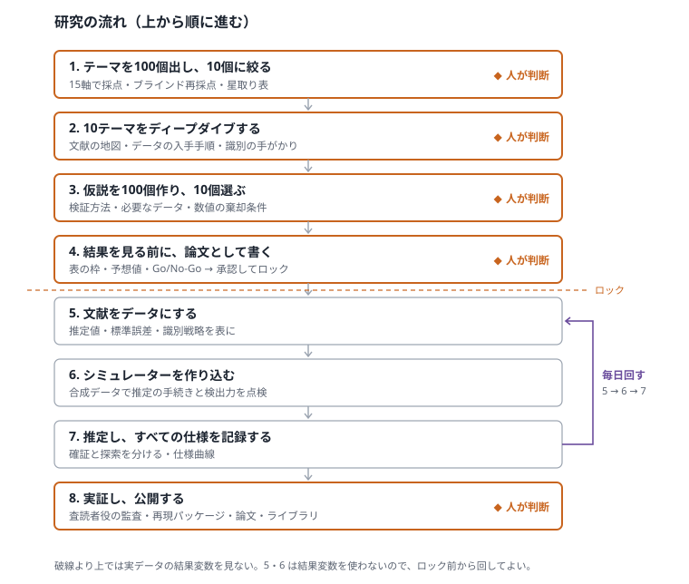
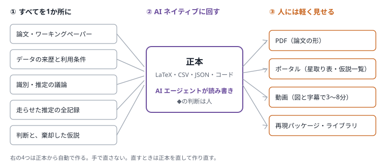

# AI ネイティブ経済学ラボとは

> 正本: このファイル。ポータルのトップページはここから自動で作る。図は `common/figs/lab_figs.py` で描く。
> 人もエージェントも、研究を始める前にこのページを上から読む。書き方の規則は `AGENTS.md`、倫理規定は `ETHICS.md` にある。

## 3行で言うと

1. **問いと研究デザインを大量に作って、速く捨てる。** AI が論文を大量に読み、テーマ100→10→1、仮説100→10 と絞る。選ぶのは人である。
2. **結果を見る前に、論文を大方書いておく。** 仮説・推定の方法・予想される結果・棄却条件を先に書き、弱い仮説は紙の上で落とす。
3. **すべてを1か所（正本）に書き、人には軽く見せる。** 走らせた推定も棄却した仮説も残す。図・動画・ポータルで、誰でも3分で全体をつかめるようにする。

## 全体像：上から順に進む



人が判断する関門（◆）は5か所ある。**①テーマを10個に絞る、②着手するテーマを決める、③仮説を10個選ぶ、④結果前論文を承認してロックする、⑧公開するか決める。**
残りの⑤⑥⑦は AI が毎日回し、人は結果を確かめる。

## 大事にする3つの原則



| 原則 | 意味 | 具体的には |
|---|---|---|
| ① すべてを1か所に | 文献・データの来歴・識別の議論・判断・棄却した仮説を、すべて正本に書く | 会話で終わらせない。PDF とポータルは正本から自動で作る。古い結果も消さない |
| ② AI ネイティブに回す | 調査・整理・執筆・作図・コード・推定は、まず AI エージェントがやる | 人の仕事は「問いを立てる・◆で判断する・データの利用許可を取る・AI の出力を確かめる」の4つに絞る |
| ③ 人には軽く見せる | 情報が増えるほど認知負荷は上がる。量を増やすほど、見せ方を軽くする | 結論を先に書く。1枚図・星取り表・動画・決まった箱を使う |

## 3つのトラック

因果推論だけに絞らない。テーマには必ずトラックを1つ付け、同じ軸で比べる。

| トラック | 何をする研究か | 「結果を見る前に書く」もの | シミュレーター（段階6） | 主な成果 |
|---|---|---|---|---|
| 因果推論・実証 | 政策や出来事の効果を、外生変動を使って推定する | 推定対象・推定式・標本の定義・反証テスト | 合成データで推定量の偏りと検出力を点検する | 実証論文 |
| 構造推定 | 経済モデルのパラメータを推定し、反実仮想を計算する | モデル・推定に使うモーメント・当てはまりを確かめる取り置きデータ | モデルそのもの。合成データでパラメータを回収できるか | 実証論文＋推定コード |
| 推定量・計量手法 | 新しい推定量・検定・計算手法を作り、性質を示す | 主張する性質・比べる既存手法・シミュレーションの設定と評価指標 | モンテカルロ実験が主役 | 手法論文＋ライブラリ |

## 通常の研究とどこが違うか

| | 通常の研究 | AI ネイティブ経済学ラボ |
|---|---|---|
| テーマの選び方 | 手元のデータと関心から1つ選ぶ | 100個を15軸で採点し、根拠を残して10→1に絞る |
| 先行研究 | 数十本を人が読む | 数百本を AI が読み、推定値・標準誤差・手法を表にする |
| 仮説 | 少数を温める | 100個作って10個選ぶ。全部に数値の棄却条件を付ける |
| 論文を書く時期 | 結果が出てから | **結果を見る前に**書く。表の枠と予想値、Go/No-Go まで書く |
| 仕様の探索 | 記録に残らない | 走らせた推定は全件残る。何本試したかが分かる |
| 査読 | 投稿後に初めて受ける | 投稿前に、別のエージェントが査読者として監査する |
| 成果 | 論文 | 論文に加えて、再現パッケージとライブラリ |
| 知の置き場 | 人の頭の中 | ポータル。新しく来た人も AI も、同じ地図から始められる |

## 8つの段階：何をして、何を大事にするか

各段階で **AI が下書きし、人が確かめる**。◆の段階では、人が判断して理由を `decision` 箱に書く。

### 1. テーマを100個出し、10個に絞る ◆

- **AI**: 分野とトラックを横断して候補を100個出し、15軸で採点する。別のエージェントがブラインドで再採点し、甘辛を補正する。
- **人**: ポータルの星取り表で、4群の点を見比べる。重く見たい項目で並べ替え、偏らない組合せで上位10個を承認する。
- **大事にすること**: 捨てる勇気。「識別できるか」「検出できるか」を重要度と同じ重さで見る。落とした理由も残す。
- **成果物**: `theme/research/themes.csv`, `scored.csv`、`theme/paper/main.tex`
- **実例**: [研究テーマをどう選ぶか](theme/paper/main.tex)、[星取り表](theme/research/themes.csv)（12テーマの試行採点）

### 2. 10テーマをディープダイブする ◆

- **AI**: 1テーマ1文書。文献の地図・未解決の問い・使えるデータと入手手順・識別の手がかり・競合・6か月計画を書く。
- **人**: 文書と動画を見て、着手するテーマを1〜2個に決める。
- **大事にすること**: 読んだ人が5分で選べること。データは「あるらしい」で終わらせず、申請手順・期間・費用・公開可否まで調べる。
- **成果物**: `deepdive/<TID>.md`

### 3. 仮説を100個作り、10個選ぶ ◆

- **AI**: 先行研究から、5つの型（延長・尖り・組合せ・異分野転用・追試と拡張）で仮説を作る。各仮説に、根拠論文・検証方法・必要なデータ・**数値の成功基準と棄却条件**を付ける。
- **人**: 信頼性・検出力・新規性・重要度で10個を選ぶ。
- **大事にすること**: 数値の棄却条件がない仮説は、仮説として扱わない。どちらの結果でも知見になる問いを優先する。
- **成果物**: `<project>/hypotheses/hypotheses.json`、`main.tex` の `hypothesis` 箱

### 4. 結果を見る前に、論文として書く ◆

- **AI**: 要旨→背景→先行研究→仮説→データ→方法→予想される結果→考察→Go/No-Go の順で、論文の形で書く。表は枠だけ作り、予想値は「仮定」と明記する。
- **人**: 「この結果が出たら何が言えるか」を確かめる。良ければ承認し、ロックする（下の「ロックとは何か」）。
- **大事にすること**: 書いてみて弱い仮説は、時間を使う前に落とす。方法は再現できる粒度で書く。
- **成果物**: `<project>/paper/main.tex`、`<project>/prereg/LOCK.json`

### 5. 文献をデータにする

- **AI**: 論文から推定値・標準誤差・標本・手法を表にする。「なぜその仕様か」の記述は文章のまま出典つきで残す。
- **人**: 抽出結果を原文と抜き取りで照合する（例: 50件）。精度を記録する。
- **大事にすること**: 効果の大きさの見当はここから付ける。都合のよい1本だけを使わない。
- **成果物**: `literature/papers.csv`（文献マスター表。1文献1行）、`<project>/research/estimates.csv`（1推定値1行）

### 6. シミュレーターを作り込む

- **AI**: 真の答えが分かっている合成データを作り、推定の手続きが答えを回収できるかを測る。構造推定ではモデル自体をここに置く。手法の研究ではここが主役になる。
- **人**: 合成データの前提が、制度と実データの成り立ちに合っているか確かめる。
- **大事にすること**: うまく回収できない設定こそ記録する。分析コードは合成データで端から端まで通してから、実データに当てる。
- **成果物**: `<project>/sim/`、`<project>/data/sim/`

### 7. 推定し、すべての仕様を記録する（5〜7は毎日回す）

- **AI**: ロックした仕様を推定する。走らせた推定は全件 `log/specs.csv` に残す。頑健性と反証テストを出し、`result` 箱を日付つきで足す。
- **人**: 制度の知識で結果を疑う。データの異常を確かめる。
- **大事にすること**: 確証と探索を混ぜない。探索で見つけたことは「次の仮説」であり、別のデータで確かめるまで結論にしない。
- **成果物**: `<project>/log/specs.csv`、`main.tex` の `result` 箱

### 8. 実証し、公開する ◆

- **AI**: 結果を成功基準と照合し、支持／棄却の判定を下書きする。別のエージェントが査読者として監査する。再現パッケージとライブラリを整える。
- **人**: Go／No-Go／ピボットを決める。出す先（学会・査読誌・ライブラリの公開）を決める。
- **大事にすること**: 公開の**前に**、データの利用規約・倫理審査・秘匿審査の要否を確かめる。棄却された仮説も結果として残す。
- **成果物**: `research/audit-*.md`、`decision` 箱、再現パッケージ、ライブラリ

## ロックとは何か

元のラボの「実験の前に論文を書く」に当たる。化学では、実験する前には結果が存在しない。
経済学ではデータが先に手元にあるので、「まだ結果を見ていない」という時点を自分で作る必要がある。その時点に押す日付印がロックである。

| | 内容 |
|---|---|
| **何を固定するか** | 段階4で書いた論文のうち、①仮説、②推定の方法（推定式・モデル）、③標本の定義、④主な結果変数、⑤成功基準と棄却条件 |
| **どうやって** | 人が承認した後に `python3 tools/lock_pap.py <project>` を実行する。`paper/main.tex` と `hypotheses.json` の指紋（ハッシュ値）と日時が `prereg/LOCK.json` に記録される。これをコミットする |
| **ロックの前にしてよいこと** | 文献を読む。合成データでコードを書いて通す。実データの説明変数と標本の構成（件数・欠損）を見る |
| **ロックの前にしてはいけないこと** | 実データの結果変数を見る・集計する・図にする・推定する。`log_spec()` は、未ロックのまま実データの推定を記録しようとすると止まる |
| **ロックの後** | 固定した仕様で推定する（これが「確証」）。結果を `result` 箱に足していく |
| **後から変えたくなったら** | 変えてよい。ただし理由と日付を更新履歴に書き、もう一度ロックする。`lock_pap.py --check` が、前回のロックから変わったファイルを教える |
| **結果を見て思いついた分析** | やってよい。「探索」と名札を付けて記録し、本文でも探索と書く。確証と同じ重みでは語らない |

ロックは、仕様を変えることを禁じる仕組みではない。**いつ・何を・なぜ変えたかが残る**ようにする仕組みである。
守れないこともある。記録を通さずにデータを見ることは止められないし、リポジトリ内の記録は第三者への証明としては弱い。
強い証明が要るときは、外部の登録簿にも出す。

## データの秘匿区分（AI に何を見せてよいか）

Claude Code も外部の AI サービスである。データを読ませることは、外部に送ることと同じである（`ETHICS.md` 第4条）。

| 区分 | 例 | エージェントに許すこと |
|---|---|---|
| T0 公開 | 公的統計の公表値、公開パネル、公開済みの再現データ、合成データ | 生データを読む・推定する |
| T1 制限 | 利用申請が要る個票、購入データ | コードを書く。集計値・推定結果・ログだけを見る |
| T2 秘匿 | オンサイト施設の行政データ、個人が特定できる情報 | 合成データでコードを書くだけ。実行は人が行う |

区分は `<project>/data/README.md` に書く。書かれていないデータは T2 として扱う。

## 道具の使い分け

| 道具 | 何に使う | 注意 |
|---|---|---|
| Claude Code（このリポジトリ） | 調査・執筆・コード・推定・作図・ビルド | 成果は必ずファイル（正本）に書かせる |
| ポータル（`portal/`） | 全員の共通の地図。星取り表・文書・動画 | 手で直さない。正本を直して `python3 portal/build.py` |
| 動画（`<project>/video/`） | 1本の文書を、図と字幕で3〜8分にまとめる | 内容は正本にあるものだけ。規約は `common/video/STYLE.md` |
| R | 推定と作図の主力（`<project>/code/`） | 推定は `log_spec()` を通す |
| Python | 道具類と、公開するライブラリ（`<project>/python/`） | 推定に使うときは `speclog.py` を通す |
| 文献マスター表（`literature/papers.csv`） | 読んだ文献の唯一の正。各プロジェクトの文献ファイルはここから作る | 論文の本体は保存しない。読んだ深さを正直に書く |
| Crossref API | DOI の照合（`python3 tools/litdb.py verify`） | 照合できない DOI は書かない |
| LaTeX（LuaLaTeX） | 正本と PDF | ウェブで崩れない書き方は `AGENTS.md` §3 |

## 進め方の指示（人もエージェントも、この順で）

1. **今どこにいるか確かめる。** `<project>/README.md` と `main.tex` の「判断と次の一手」を読み、図1のどの段階か言えるようにする。
2. **ロックの状態を確かめる。** `python3 tools/lock_pap.py <project> --check`。
3. **その段階の成果物を作る。** 新しいファイルを増やさず、同じ `main.tex` に積み上げる。
4. **事実には出典を付ける。** 推測は「仮説」「筆者の見解」と書く。推定値には標準誤差か信頼区間・n を付ける。
5. **図にする。** 1節に1枚を目安に、言いたいことを図で示す。大きな文書には動画を付ける。
6. **◆では人が判断する。** 判断・理由・次の一手（誰が・いつまでに）を `decision` 箱に書く。
7. **ビルドして見る。** `latexmk` で PDF（エラー0・未定義引用0）、`python3 portal/build.py` でポータル（変換警告0）。
8. **更新履歴に1行足す。**

## AI への頼み方（コピーして使う）

```text
[1] <分野> で研究テーマの候補を100個出し、theme/research/00_plan.md の15軸で採点して。
    3つのトラックを混ぜること。根拠 URL を付け、python3 tools/score_themes.py で順位を出し、ポータルを更新して。
[2] テーマ <TID> をディープダイブして deepdive/<TID>.md に書いて。データは入手手順・期間・費用・秘匿区分まで調べて。
[3] <project> の文献から、5つの型で仮説を100個作り、検証方法・必要なデータ・数値の成功基準と棄却条件を付けて
    hypotheses/hypotheses.json に書いて。上位10個を main.tex の hypothesis 箱に書いて。
[4] <project> の仮説 H<n> を、結果を見る前の論文として paper/main.tex に書いて。表は枠だけ、予想値は仮定と明記。
    sim/ で検出力を出し、Go/No-Go 基準を入れて。実データの結果変数には触れないで。
[5] <project> の文献から推定値・標準誤差・n・手法を抽出して research/estimates.csv にして。
    ランダムに50件を原文と照合し、精度を報告して。
[7] ロック済みの仕様を推定し、main.tex に日付つきの result 箱を足して。確証と探索を分けて。
[8] 査読者として <project> を監査し、research/audit-<日付>.md に指摘と対応を書いて。
[動画] <project> の main.tex を、common/video/STYLE.md の構成で動画にして。数値は本文にあるものだけ使って。
```

## 守ること

- 成果は会話で終わらせず、正本に書く。ポータルの生成物は手で直さない。
- 事実には出典を付ける。DOI は Crossref で照合したものだけ書く。AI の要約は原文で確かめる。
- 仮説には数値の棄却条件を付ける。予想値は「仮定」と書く。
- ロック前に実データの結果変数を見ない。ロック後の変更は理由と日付を残す。
- 走らせた推定はすべて残す。確証と探索を書き分ける。
- 古い結果・有意でない結果・棄却した仮説を消さない。
- データは秘匿区分に従う。倫理規定（`ETHICS.md`）に反するおそれがあれば、止めて人に上げる。
- ◆の判断は人が行い、理由を書く。
- 量を増やしたら、見せ方を軽くする。結論を先に、図を多く。

## 元のラボから変えた点

このラボは [INDXDev/indx-lab](https://github.com/INDXDev/indx-lab)（化学・物理むけ、特許優先）の進め方を、経済学・計量経済学に移したものである。

| 元のラボ | 経済学版 | 理由 |
|---|---|---|
| 成果は特許 | 成果は学会発表・査読論文、またはライブラリ | 経済学の成果は特許にならない |
| 実験の前に論文を書く | 結果を見る前に論文を書き、ロックする | データが先にあるので、「前」を自分で作る |
| シミュレーター＝物理モデル | 合成データで推定の手続きを点検する。構造推定ではモデルそのもの | 物理法則に当たるものがない |
| 実験ノートを全部残す | 走らせた推定を全部残す | 失敗の隠れ方が違う（選択的な報告） |
| 公開前に特許の要否を確認 | 公開前にデータ規約・倫理審査を確認。倫理規定を持つ | 止まる理由が違う |
| 13軸（市場規模・知財化しやすさ…） | 15軸（識別の信頼性・検出力・ライブラリ価値…） | `theme/paper/main.tex` |
| 分野は1つ（材料） | 3トラック（因果推論・構造推定・推定量） | 計量経済学の幅を残す |
